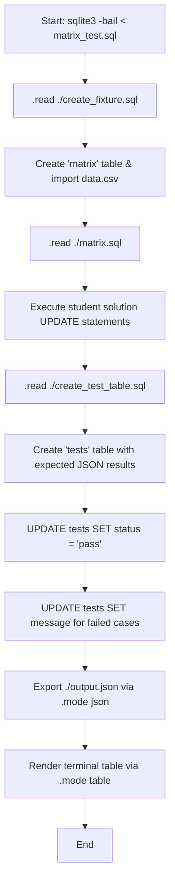

# Matrix Exercise Maintenance Documentation

This document describes the file-role architecture, configuration structure, and test runner mechanics for the `matrix` practice exercise in the SQLite track of Exercism.

---

## 1. File-Role Architecture

The `exercises/practice/matrix/` directory consists of decoupled files serving distinct roles in exercise delivery, evaluation, and track configuration:

| File Path | Role | Description |
| :--- | :--- | :--- |
| `matrix.sql` | **Learner Solution Stub** | Starter file provided to students. Contains schema documentation comments and the starter table definition. Must not be modified or contain complete solution logic. |
| `matrix_test.sql` | **Test Harness** | The entry-point script executed by the SQLite test runner (`sqlite3 -bail < matrix_test.sql`). Coordinates fixture setup, student solution execution, test comparison, and `output.json` generation. |
| `.meta/example.sql` | **Reference Implementation** | Track maintainer reference solution. Demonstrates parsing multiline space-delimited string matrices using SQLite string functions (`REPLACE`, `PRINTF`) and JSON table functions (`JSON_EACH`, `JSON_GROUP_ARRAY`, `JSON_EXTRACT`). |
| `create_fixture.sql` | **Fixture Setup** | Drops any pre-existing `matrix` table, creates the table schema, imports `data.csv`, nullifies `result`, and converts literal `\n` substrings into newline characters (`CHAR(10)`). |
| `create_test_table.sql` | **Test Data Fixture** | Declares the `tests` table and inserts all canonical test cases with expected JSON string outputs (`tests.expected`). |
| `data.csv` | **Input Data** | CSV dataset imported by `create_fixture.sql` to populate initial test inputs into `matrix`. |
| `.meta/config.json` | **Track Configuration** | Declares author credits, exercise blurb, source provenance, and critical file role mappings (`solution`, `test`, `example`). |
| `.meta/tests.toml` | **Canonical Test Registry** | Maps upstream Exercism problem-specifications UUIDs to test descriptions, controlling inclusion and synchronization state. |
| `.meta/template.create_test_table.j2` | **Test Template** | Jinja2 template used by `bin/generate_tests` to regenerate `create_test_table.sql`. |

---

## 2. Test Runner Mechanics

The test execution flow follows a multi-stage sequential database script defined in `matrix_test.sql`:



### Detailed Execution Stages

1. **Stage 1: Fixture Creation (`create_fixture.sql`)**:
   - Resets state by dropping table `matrix` if it exists.
   - Creates table `matrix (property TEXT NOT NULL, string TEXT NOT NULL, "index" INTEGER NOT NULL, result TEXT)`.
   - Imports `data.csv` using SQLite CSV mode (`.mode csv; .import ./data.csv matrix`).
   - Resets `result = NULL` and normalizes escaped newlines:
     ```sql
     UPDATE matrix SET string = REPLACE(string, '\n', CHAR(10));
     ```

2. **Stage 2: Solution Execution (`matrix.sql`)**:
   - Executes student solution queries (or `.meta/example.sql` during track verification).
   - The solution updates `result` with a JSON-formatted array of integers (e.g. `'[1, 2, 3]'`) matching the specified `property` (`'row'` or `'column'`) and 1-based `"index"`.

3. **Stage 3: Test Table Setup (`create_test_table.sql`)**:
   - Recreates the `tests` table containing tracking columns (`uuid`, `description`, `status DEFAULT 'fail'`, `message`, `output`, `test_code`, `task_id`) and test inputs (`property`, `string`, `"index"`, `expected`).
   - Inserts all 8 canonical test cases.
   - Normalizes newlines in test board strings to match fixture data:
     ```sql
     UPDATE tests SET string = REPLACE(string, '\n', CHAR(10));
     ```

4. **Stage 4: Verification & Grading**:
   - Compares the learner's actual output with the test fixture's expected output using JSON equality:
     ```sql
     UPDATE tests
     SET status = 'pass'
     FROM (
       SELECT property, string, "index", result FROM matrix
     ) AS actual
     WHERE (
       actual.property,
       actual.string,
       actual."index",
       JSON(actual.result)
     ) = (
       tests.property,
       tests.string,
       tests."index",
       JSON(tests.expected)
     );
     ```
   - Normalizing with `JSON()` ensures whitespace or formatting differences in JSON string representations do not produce false failures.

5. **Stage 5: Failure Messaging**:
   - For all tests retaining `status = 'fail'`, constructs a diagnostic message indicating actual vs. expected results:
     ```sql
     UPDATE tests
     SET message = (
       'Result for "' || PRINTF('property=%s,string=%s,index=%d', tests.property, tests.string, tests."index")
       || '" is <' || COALESCE(actual.result, 'NULL') || '> but should be <' || tests.expected || '>'
     )
     FROM (SELECT property, string, "index", result FROM matrix) AS actual
     WHERE (actual.property, actual.string, actual."index") = (tests.property, tests.string, tests."index")
       AND tests.status = 'fail';
     ```

6. **Stage 6: Output Emission**:
   - Emits structured results to `output.json` (`.mode json; .once './output.json'`) for automated track grading.
   - Formats human-readable test summaries in markdown and ASCII table mode for local student feedback.
